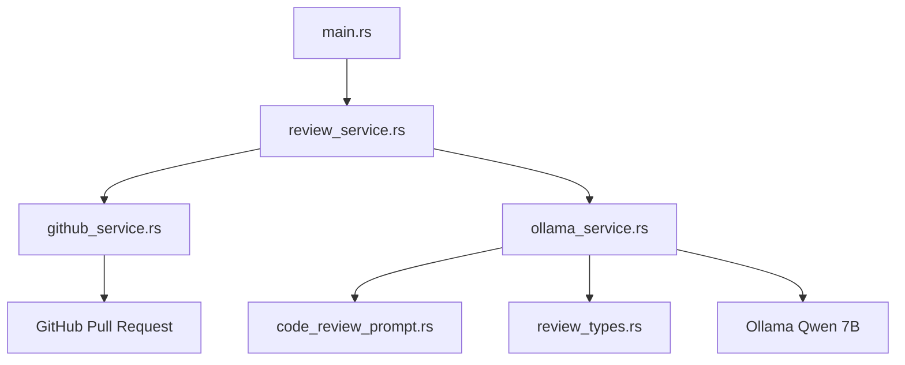

# Ollama Code Reviewer

[](https://www.rust-lang.org/)
[](https://ollama.com/)
[](https://ollama.com/library/qwen2.5-coder)
[](https://github.com/JianoFreo/ollama-code-reviewer/issues)
[](https://github.com/JianoFreo/ollama-code-reviewer/commits)

An automated GitHub Pull Request code review tool powered by Ollama and Qwen 2.5 Coder. It retrieves modified files from a GitHub repository, analyzes their changes using AI, and generates a Markdown code review that can optionally be published directly to the Pull Request.

## Architecture



---

# 1. Prerequisites

Install the following before running the application:

| Requirement | Description |
|---|---|
| Rust 1.85+ | Rust compiler and Cargo package manager. |
| Git | Clone the repository. |
| Ollama | Runs the local AI model. |
| GitHub Account | Provides access to the target repository and Pull Requests. |


---

# 2. Configure Environment Variables

Create a `.env` file in the project root, alongside `Cargo.toml`.

### Local AI Configuration

```env
# AI Configuration -- locally
AI_PROVIDER=ollama
AI_BASE_URL=http://localhost:11434
AI_MODEL=qwen2.5-coder:7b
AI_API_KEY=
```

Leave `AI_API_KEY` empty when using local Ollama.

### GitHub Configuration

```env
# GitHub Configuration
GITHUB_API_URL=https://api.github.com
GITHUB_TOKEN=github_pat_...
GITHUB_OWNER=your-github-username
GITHUB_REPO=your-repository-name
```

| Variable | Description |
|---|---|
| `GITHUB_API_URL` | GitHub API URL. Leave unchanged unless using GitHub Enterprise. |
| `GITHUB_TOKEN` | GitHub Personal Access Token. |
| `GITHUB_OWNER` | Repository owner's username. |
| `GITHUB_REPO` | Target repository name. |

### Optional Application Configuration

```env
# Application
NODE_ENV=development
PORT=3000
```

These variables are retained from the original configuration but are currently unused.

---

# 3. Generate a GitHub Token

The application needs a GitHub Fine-grained Personal Access Token to retrieve Pull Request files and publish reviews.

1. Go to [GitHub Settings](https://github.com/settings/personal-access-tokens).
2. Select **Fine-grained tokens**.
3. Click **Generate new token**.
4. Enter a token name.
5. Under **Repository access**, select **Only select repositories** and choose your target repository.
6. Under **Repository permissions**, configure:
   - Pull requests: **Read and write**
   - Metadata: **Read-only** (automatically included).
7. Generate the token and copy it immediately.

Paste the token into your `.env` file:

```env
GITHUB_TOKEN=github_pat_...
```

**Important:** Never commit your `.env` file or expose your GitHub token publicly. Add `.env` to `.gitignore`.

---

# 4. Build and Run

Navigate to the project root:

```bash
cd ollama-code-reviewer
```

Build the application:

```bash
cargo build
```

Cargo automatically downloads and compiles the required dependencies.

### Available Commands

| Command | Description |
|---|---|
| `cargo run` | Run the built-in sample code review. |
| `cargo run -- 12` | Review GitHub Pull Request #12. |
| `cargo run -- 12 --post` | Review PR #12 and publish the result to GitHub. |
| `cargo review` | Run the sample review using the configured shortcut. |
| `cargo review 12` | Review PR #12. |
| `cargo review 12 --post` | Review PR #12 and publish the result. |
| `cargo build --release` | Build an optimized executable. |
| `cargo start 12` | Run the optimized executable against PR #12. |
| `cargo test` | Run automated tests. |
| `cargo dev` | Run with automatic rebuilds when files change. |

`cargo review`, `cargo start`, and `cargo dev` are shortcuts configured in `.cargo/config.toml`.

For automatic rebuilding during development, install:

```bash
cargo install cargo-watch
```

### Example Execution

Review a Pull Request without publishing:

```bash
cargo review 12
```

Review and publish the results:

```bash
cargo review 12 --post
```

Replace `12` with the actual Pull Request number.

### Release Build

Generate an optimized executable:

```bash
cargo build --release
```

Output:

**Windows:**
```text
target/release/ollama-code-reviewer.exe
```

**Linux / macOS:**
```text
target/release/ollama-code-reviewer
```

The compiled executable can run without installing Rust on the target machine, provided the operating system and architecture are compatible. The `.env` configuration and access to Ollama are still required.

---

# 5. Project Structure

```text
.
├── Cargo.toml
├── Cargo.lock
├── .cargo/
│   └── config.toml
├── .env
├── target/
└── src/
    ├── main.rs
    ├── config/
    │   ├── mod.rs
    │   └── env.rs
    ├── prompts/
    │   ├── mod.rs
    │   └── code_review_prompt.rs
    ├── services/
    │   ├── mod.rs
    │   ├── github_service.rs
    │   ├── ollama_service.rs
    │   └── review_service.rs
    └── types/
        ├── mod.rs
        └── review_types.rs
```

- `main.rs`: Application entry point.
- `config/`: Environment configuration.
- `prompts/`: AI system prompts.
- `services/github_service.rs`: GitHub API integration.
- `services/ollama_service.rs`: Ollama API integration.
- `services/review_service.rs`: Main code review workflow.
- `types/`: Shared data structures.

---

# 6. Additional Notes

- **AI Provider:** The current implementation only supports Ollama. Although `AI_PROVIDER` is included in the configuration, it does not currently switch between providers.
- **OpenAI Configuration:** Cloud AI support is not implemented yet. The application always uses Ollama's `/api/chat` endpoint.
- **Pull Request Limits:** GitHub file retrieval currently processes a maximum of 100 changed files per Pull Request. Pagination is not implemented.
- **Individual File Errors:** If a file fails during AI analysis, its error is recorded in the report and processing continues with the remaining files.
- **Sample Review:** Running without a Pull Request number uses a built-in sample diff, allowing you to test the AI integration without accessing GitHub.
- **Ollama Availability:** Ensure Ollama is running and the configured model is available before starting a review.
- **GitHub Permissions:** The token needs Pull Requests read and write permissions if you intend to publish reviews.

---

## Troubleshooting

| Issue | Possible Solution |
|---|---|
| Cannot connect to Ollama | Start Ollama using `ollama serve`. |
| Model not found | Run `ollama pull qwen2.5-coder:7b`. |
| GitHub authentication failed | Verify `GITHUB_TOKEN` and repository permissions. |
| Repository not found | Check `GITHUB_OWNER` and `GITHUB_REPO`. |
| Missing environment variables | Verify that `.env` is in the project root. |
| Cargo command not found | Verify Rust installation and reopen your terminal. |
| Build errors | Run `rustc --version` and ensure Rust 1.85 or newer is installed. |
