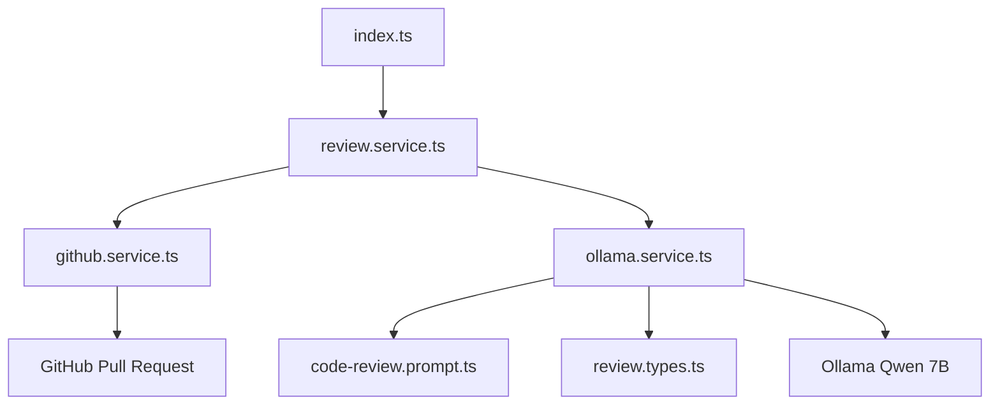

# .env
```.env
# AI Configuration -- locally 
AI_PROVIDER=ollama
AI_BASE_URL=http://localhost:11434
AI_MODEL=qwen2.5-coder:7b
AI_API_KEY=

# AI Configuration -- cloud based
AI_PROVIDER=openai
AI_BASE_URL=https://api.openai.com/v1
AI_MODEL=gpt-6
AI_API_KEY=your_openai_api_key

# GitHub Configuration
GITHUB_API_URL=https://api.github.com
GITHUB_TOKEN=
GITHUB_OWNER=JianoFreo
GITHUB_REPO=ollama-code-reviewer

# Application
NODE_ENV=development
PORT=3000
```