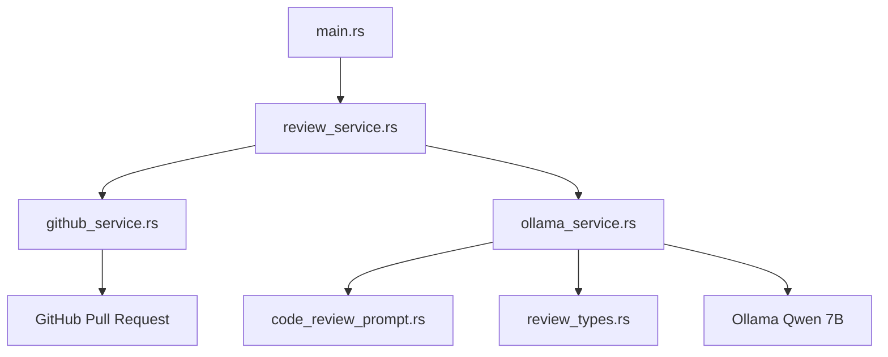

# .env
```.env
# AI Configuration -- locally 
AI_PROVIDER=ollama
AI_BASE_URL=http://localhost:11434
AI_MODEL=qwen2.5-coder:7b
AI_API_KEY=Leave it empty. Local Ollama doesn’t need a key.

# AI Configuration -- cloud based
AI_PROVIDER=openai
AI_BASE_URL=https://api.openai.com/v1
AI_MODEL=gpt-6
AI_API_KEY=your_openai_api_key

# GitHub Configuration
GITHUB_API_URL=https://api.github.com #Leave it as is. Only change it if you use GitHub Enterprise.
GITHUB_TOKEN=
GITHUB_OWNER=JianoFreo #The first part of the repo URL: github.com/owner/repo
GITHUB_REPO=# The second part of the repo URL: github.com/owner/repo

Paste it in: GITHUB_TOKEN=github_pat_...
# Application
NODE_ENV=development
PORT=3000
```
# Generate the token
   - Go to github.com → click your profile picture → Settings.
   - Scroll down to Developer settings → Personal access tokens → Fine-grained tokens.
   - Click Generate new token and give it a name.
   - Under Repository access, choose Only select repositories and pick the repo from above.
   - Under Permissions → Repository permissions, set Pull requests to Read and write. (GitHub adds Metadata: Read automatically.)
   - Click Generate token and copy it right away, because GitHub only shows it once.


---

# 🦀 Rust version — setup & running

This is the same project as the TypeScript one, same folders, same file names
(`review.service.ts` → `review_service.rs`), same `.env`. Only the language changed.
Every file has comments showing the TypeScript line each piece replaces.

## 1. Install Rust (one time)

Rust installs with **rustup** (think `nvm` + `npm` in one). It gives you `cargo`.

- **macOS / Linux:** `curl --proto '=https' --tlsv1.2 -sSf https://sh.rustup.rs | sh`
- **Windows:** download and run `rustup-init.exe` from https://rustup.rs
  (it will ask you to install the Visual Studio C++ Build Tools — say yes, it's required).

Then **open a new terminal** and check it worked (you need Rust **1.85 or newer**):

```bash
cargo --version
rustc --version
```

## 2. Make sure Ollama is running

```bash
ollama pull qwen2.5-coder:7b     # one time
ollama serve                     # skip if the Ollama app is already running
```

## 3. Create your `.env`

Same file, same variable names as the Node version (see the `.env` section above). Put it in the
project root, next to `Cargo.toml`. A minimal local setup:

```.env
AI_BASE_URL=http://localhost:11434
AI_MODEL=qwen2.5-coder:7b
GITHUB_TOKEN=github_pat_...
GITHUB_OWNER=your-github-username
GITHUB_REPO=your-repo-name
```

> **Tips for the `.env` above**
> - If you copy the big block from the top of this README, the line `AI_API_KEY=Leave it empty...` is an
>   *instruction*, not a value. Delete the text after `=` (leave it blank) for local Ollama.
> - That block contains **two** `AI_*` sections. If a key appears twice the **last one wins** (this is true in
>   Node's dotenv too), so you'd end up on the OpenAI settings. Keep only the section you want.

## 4. Run it — `npm` vs `cargo`

| What you did in Node | What you do in Rust | Notes |
| --- | --- | --- |
| `npm install` | *(nothing)* | `cargo` downloads dependencies automatically the first time you build |
| `npm run review` | `cargo review` | compile + run once (reviews the built-in sample diff) |
| `npm run review -- 12` | `cargo review 12` | review PR #12 and print the result |
| `npm run review -- 12 --post` | `cargo review 12 --post` | review PR #12 **and post it to GitHub** |
| `npm run dev` (nodemon) | `cargo dev` | re-runs on every save. One-time setup: `cargo install cargo-watch` |
| `npm run build` (tsc) | `cargo build --release` | creates `target/release/ollama-code-reviewer` |
| `npm start` (node dist/index.js) | `cargo start 12` &nbsp;or&nbsp; `./target/release/ollama-code-reviewer 12` | run the optimized build |

(`cargo review`, `cargo dev` and `cargo start` are shortcuts defined in `.cargo/config.toml`,
the same idea as the `"scripts"` block in `package.json`. Plain `cargo run -- 12 --post` works too.)

**First build is slow** (1–3 minutes) because Cargo compiles all the dependencies once. After
that, rebuilds take a few seconds.

**The release binary is standalone.** `target/release/ollama-code-reviewer` (on Windows,
`target\release\ollama-code-reviewer.exe`) needs no Rust and no Node installed. You can copy it to any
machine of the same OS. Just run it from the folder that contains your `.env`.

Run the tests (only the `.env` loader has any): `cargo test`

## 5. Project layout (same as before)

```
.
├── Cargo.toml                       ← package.json  (+ tsconfig notes)
├── Cargo.lock                       ← package-lock.json
├── .cargo/config.toml               ← the "scripts" block (cargo review / dev / start)
├── .env                             ← your secrets (git-ignored, same as before)
├── target/                          ← dist/ + node_modules (compiled output, git-ignored)
└── src/
    ├── main.rs                      ← index.ts
    ├── config/
    │   ├── mod.rs                   ← (index.ts "barrel": lists the folder's files)
    │   └── env.rs                   ← env.ts
    ├── prompts/
    │   ├── mod.rs
    │   └── code_review_prompt.rs    ← code-review.prompt.ts
    ├── services/
    │   ├── mod.rs
    │   ├── github_service.rs        ← github.service.ts
    │   ├── ollama_service.rs        ← ollama.service.ts
    │   └── review_service.rs        ← review.service.ts
    └── types/
        ├── mod.rs
        └── review_types.rs          ← review.types.ts
```

Why the extra `mod.rs` files? In Node, a file joins your program the moment something `import`s it.
In Rust you must *declare* each folder with `mod foo;` (in `main.rs`) and list its files in that folder's
`mod.rs`. A file nobody declares is simply not compiled.

---

# 🧭 How it works

## What happens when you run `cargo review 12 --post`

1. **`main.rs`** starts. It reads the arguments: `12` is the PR number and `--post` means "post the result
   to GitHub". With no number it reviews a hard-coded sample diff instead (a quick way to test Ollama).
2. It calls **`review_pull_request(12, true)`** in `review_service.rs`, the brain of the app.
3. That asks **`github_service.rs`** for the list of files changed in PR #12
   (`GET /repos/{owner}/{repo}/pulls/12/files`). It sends your token and the GitHub API headers.
4. `review_service.rs` **filters out noise**: lock files, images/fonts, minified files, `dist/` /
   `build/` / `node_modules/` and any file GitHub gave no patch for.
5. For **each remaining file**, it:
   - cuts the patch to 12,000 characters (small local models choke on huge inputs),
   - builds a small text: file name + status + patch,
   - calls **`ollama_service.rs`**, which sends it to Ollama's `/api/chat` together with the system prompt
     from `code_review_prompt.rs`, and returns the model's answer.
   - If one file fails, the error is written into the report for that file and the rest continue.
6. All the per-file answers are joined into one Markdown report ("## Automated Code Review").
7. With `--post`, that report is sent back to GitHub as a PR review comment
   (`POST /repos/{owner}/{repo}/pulls/12/reviews`). Either way it's printed to your terminal.

## TypeScript → Rust cheat sheet

| TypeScript | Rust | Meaning |
| --- | --- | --- |
| `import { x } from "./y.js"` | `use crate::y::x;` | bring something into scope |
| `export function f()` | `pub fn f()` | make it usable from other files |
| `const a = 1` / `let a = 1` | `let a = 1;` / `let mut a = 1;` | **variables are read-only unless you say `mut`** |
| `string` | `String` / `&str` | `String` = owned text, `&str` = borrowed (read-only) text |
| `string \| undefined` | `Option<String>` | `Some("x")` or `None`; you *must* handle `None` |
| `string[]` | `Vec<String>` | growable list |
| `interface Foo {}` | `struct Foo {}` | a data shape |
| `"low" \| "high"` | `enum { Low, High }` | a fixed set of choices |
| `throw new Error("x")` | `bail!("x")` | fail with a message |
| `try { } catch { }` | `match result { Ok(..) => .., Err(..) => .. }` | handle success or failure |
| `await somePromise` (and let errors bubble up) | `some_future().await?` | the `?` means "if it failed, return that error from my function" |
| `async function f(): Promise<T>` | `async fn f() -> Result<T>` | async functions that can fail |
| `a ?? b` | `a.unwrap_or(b)` | default value |
| `` `Hi ${name}` `` | `format!("Hi {name}")` | string interpolation |
| `console.log(x)` | `println!("{x}")` | print to the terminal |
| `console.error(x)` | `eprintln!("{x}")` | print to stderr |
| `process.exit(1)` | `std::process::exit(1)` | quit with an error code |
| `arr.filter(f).map(g)` | `.iter().filter(f).map(g).collect()` | iterator chains (`collect` builds the list at the end) |
| `JSON.stringify({...})` | `json!({...})` | JSON object literal |
| `res.json() as Foo` | `res.json::<Foo>()` | **checked** at runtime (TS's `as` is just a promise to the compiler) |

## npm package → Rust crate

| npm | crate | Used for |
| --- | --- | --- |
| built-in `fetch` | `reqwest` | HTTP calls to GitHub and Ollama |
| `JSON.parse` / `JSON.stringify` | `serde`, `serde_json` | JSON ↔ typed structs |
| Node's event loop | `tokio` | runs `async` code (`#[tokio::main]` in `main.rs`) |
| `RegExp` | `regex` | the skip-patterns in `review_service.rs` |
| `try/catch` + `new Error` | `anyhow` | easy error type + `bail!` |
| `dotenv` | *(own loader in `config/env.rs`)* | reads `.env` (see the comment there for why) |
| `typescript`, `tsx`, `@types/node` | *(built into Rust)* | |
| `nodemon` | `cargo-watch` (global) | auto-restart on save |

---

# 📝 Things I noticed while converting (behavior kept the same on purpose)

- **`AI_PROVIDER` is read but never used.** The code always calls Ollama's `/api/chat` endpoint, so the
  "cloud based / OpenAI" settings in the `.env` example won't actually work: OpenAI uses a different URL
  (`/chat/completions`) and a different response shape. Supporting it would be a good next feature.
- Only the **first 100 changed files** of a PR are fetched (`per_page=100`, no paging).
- `get_pull_request_diff`, `post_review_comments` and `ReviewFinding` exist but nothing calls them yet
  (same as the TS). `PORT` and `NODE_ENV` are loaded but unused too (there's no server).
- One genuine Rust-vs-Node difference: Node's `fetch` sends a `User-Agent` header automatically, and GitHub
  rejects requests without one. `github_service.rs` sets it explicitly.
